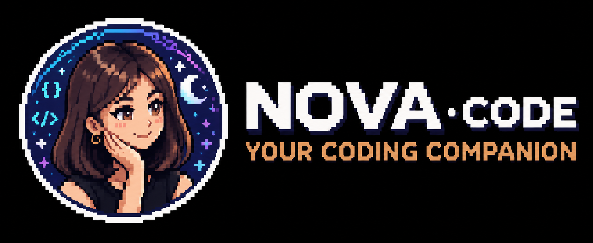
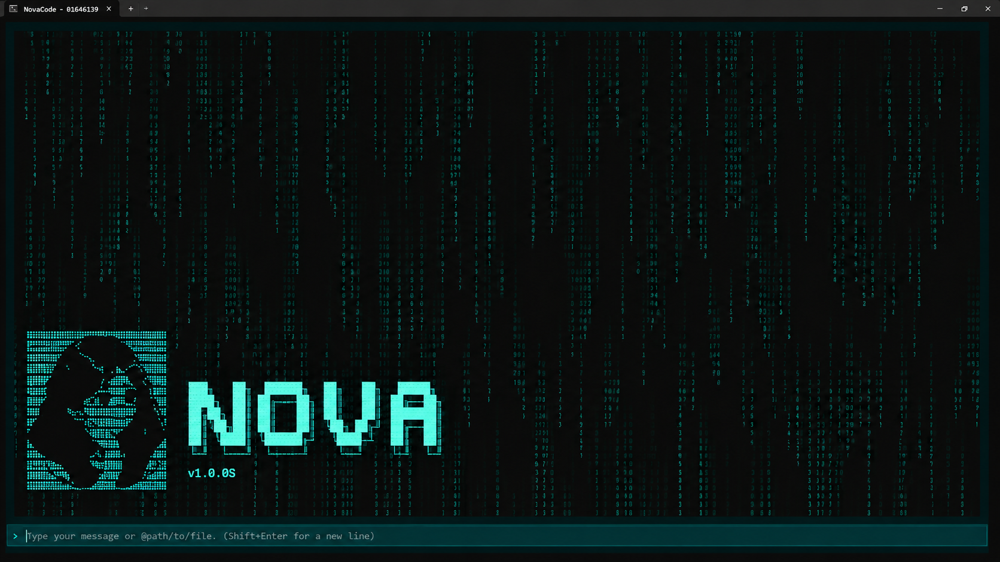

# NovaCode

An open-source terminal coding assistant that reads your project, plans changes,
edits files and runs checks. Choose cloud or local models and keep useful project
knowledge between sessions.

Built with Python, LangGraph, deepagents and Textual. [MIT licensed](LICENSE).

Native context compression uses the [billion-context](https://github.com/ranxianglei/billion-context)
and [acp-kernel](https://github.com/ranxianglei/acp-kernel) design.
See [model-controlled context compression](docs/context-compression.md) for tools, recovery and attribution.



## Get started

Install the latest release from [PyPI](https://pypi.org/project/novacode-cli/)
with **uv** on Windows CMD, macOS or Linux. Nova requires Python 3.11+; uv can
install Python 3.11 for the tool. You also need a supported model provider or
a running Ollama instance with a model installed. Current release: **1.2.16**
([changelog](https://github.com/Babitdor/NovaCode/releases/tag/v1.2.16)).

```text
uv tool install --python 3.11 novacode-cli
nova
```

First-run setup guides provider configuration and workspace approval. Hosted
models may charge for usage. Run `nova` from your project directory. Upgrade a
PyPI tool install with `uv tool upgrade novacode-cli`. To replace a Git-based
installation, use `uv tool install --python 3.11 --force novacode-cli`, adding any
wanted extras. To pin this release, use `novacode-cli==1.2.16` in the install command.

Version 1.2.16 adds native model-controlled context compression with reversible
archives, layered summaries and recovery across session resume. Before updating
from a version older than 1.2.15, exit Nova in other terminal windows; the windows
can stay open.
`/update` stays in the current terminal: launcher-enabled sessions resume
automatically; older unprotected launches show a resume command there.

For local development of Nova itself, use Git and a source checkout:

```text
git clone https://github.com/Babitdor/NovaCode.git
cd NovaCode
uv sync
uv run nova
```

For recurring work within an open local session, use `/loop 5m check CI status`,
or `/loop monitor deployment until healthy` for model-selected wakeups. Use
`/loop list` and `/loop stop` to inspect or cancel loops. Instructions in
`.nova/loop.md` reload on each file-driven iteration. See [session loops](docs/session-loops.md)
for cron schedules, TTL, skill invocations and lifecycle details.

## What Nova can do

- **Code and verify:** investigate projects, edit files, run commands and checks,
  and review changes with workspace and tool approvals.
- **Plan and delegate:** compare Council proposals, use specialist agents and
  coordinate project tabs with messages and Git worktrees.
- **Remember:** inspect and maintain a linked Markdown memory wiki, resume
  sessions and recover supported file snapshots. Inline “Recalling memory” and
  “Reading memory” notices name the sources being used without displaying their
  contents. Repeated recall of the same source is shown once per turn; the full
  memory corpus is never loaded into the prompt at once.
- **Choose and extend:** select hosted or local models, configure an independent
  vision model, and add skills, plugins and MCP servers.
- **Compose tools in Code Mode:** toggle it below the composer to combine
  eligible native and MCP tools in bounded JavaScript workflows.
- **Speak and listen:** optional speech input and short spoken reply summaries,
  including lightweight CPU voice choices and model download progress.
- **Make it yours:** choose from 13 interface styles, including character art
  and optional animated home scenes.
- **Work beyond the terminal:** use remote chats, local web workspaces, temporary
  artifact previews and headless automation.

See [FEATURES.md](FEATURES.md) for the full catalog, setup requirements and
landing-page copy.

## Everyday use

| Command | Purpose |
| --- | --- |
| `/help` | Commands and keyboard shortcuts |
| `/onboard` | Interactive code map, guided tours, architecture guide, Q&A and change impact |
| `/model`, `/auth` | Models, vision and provider access |
| `/plan`, `/council <task>` | Investigate changes and compare plans |
| `/tabs`, `/resume` | Parallel projects and saved sessions |
| `/command-center`, `/cc` | [Project-grouped sessions, live status filters and task details](docs/command-center.md) |
| `/dream`, `/context` | Memory maintenance and context inspection |
| `/settings`, `/theme` | Voice, interface styles and preferences |
| `/mcp`, `/remote` | External tools and remote chat setup |
| `/restore` | Recoverable file snapshots |

`/resume` and `nova --resume` browse saved sessions
across projects. For another project's session, choose its saved workspace or
your current workspace; either choice can be remembered with “Always use…”.
Choosing the saved workspace inside Nova opens an isolated session tab, keeping
the current chat available. Workspace trust and tool approvals still apply.
Reset the directory preference with `nova config set resume_directory ask`.

Attach files with `@`; use **Shift+Enter** for a new line. For a one-shot task:

```bash
nova -p "Summarize the changes in this repository"
```

**New to a project? Start with `/onboard`.** Inspired by
[Understand Anything](https://github.com/Egonex-AI/Understand-Anything), it parses
the local workspace with the already installed Graphify language parsers and
saves a persistent graph and guide in `.nova/onboard/`. The local artifact
dashboard provides file/symbol search, directory filters, a clickable dependency
map, a learning tour and incoming dependency impact tracing. It needs no Node
installation, browser credentials or external dashboard assets.

Use `/onboard open` to reopen the dashboard, `/onboard tour` for a conversational
tour, `/onboard ask <question>` for source-grounded Q&A, and
`/onboard impact <symbol or path>` before changing code. The dashboard's **Ask
Nova** tab prepares a command to paste into the conversation. Nova explains the
architecture and business flows using its normal model and tool permissions;
the initial deterministic guide contains structural facts only. Reopen the
dashboard after Nova enriches the guide. Model calls use your configured provider.

`/onboard refresh` rebuilds after changes. File-content fingerprints detect
new, edited and deleted inputs; saved analyses display a staleness notice.
Scans respect Git ignore rules and skip links, generated directories and common
secret filenames. Static parsing can miss dynamic dependencies; directory
groups are not semantic architecture layers. Limits: 5,000 source/Markdown
files, 1 MiB per file, 64 MiB total input and 32 MiB graph. The parsing deadline
scales with file count and input size from two to ten minutes; Escape cancels it.
Refresh replaces generated graph/guide files, so copy edited guides
elsewhere before rebuilding. This command currently requires a local workspace;
Plan Mode prevents building or refreshing the saved analysis.

## Optional features

Install common optional features into the isolated Nova tool environment:

```text
uv tool install --python 3.11 --force "novacode-cli[browser,voice,agents-server,server,bedrock,computer]"
```

Keep every wanted extra in the quoted requirement when reinstalling. Alternative
voice extras include `voice-orpheus`, `voice-parakeet`, `voice-pocket`,
`voice-whistle`, `voice-kokoro` and `voice-sano`. For example, use
`"novacode-cli[voice,voice-kokoro]"` for voice with Kokoro. Installing all voice
engines together has not been verified on Windows; native engines may require
platform support or build tools.

For a source checkout, select extras when syncing instead:

```bash
uv sync --extra voice --extra voice-kokoro
```

Keep all desired `--extra` flags when syncing. Speech models download on first
use. Extras install Python dependencies; browser binaries, models and external
runtimes may need separate setup. See [setup and usage](https://babitdor.github.io/NovaCode/docs/#page-installation)
and the [extras reference](https://babitdor.github.io/NovaCode/docs/#page-extras).

**Local computer preview:** the `computer` extra lets Nova operate a
separate Linux QEMU VM with a private live browser preview and pause/resume/stop
controls. Requires QEMU, a guest-image download and 4 GiB RAM for the guest.
Start with `/computer start`; see [computer setup and limits](COMPUTER.md).
The Windows WHPX compatibility fix in this checkout has passed a real desktop boot.

## Documentation and contributing

[Setup and usage](https://babitdor.github.io/NovaCode/docs/#page-installation) · [Feature catalog](FEATURES.md) ·
[Code Mode](docs/mcp-code-mode.md) · [Permissions](docs/security-guardrails.md) ·
[Sharing](docs/temporary-sharing.md) · [Changelog](changelog/)

For development, run `uv sync --group dev` and tests relevant to your change.
See [project instructions](AGENTS.md) for build and check commands. Report bugs
or propose changes through repository issues and pull requests.


### Compression preferences

The composer selector cycles **Off → Caveman → Ponytail → Off**. Options saves
mode, independent intensities and Caveman feature switches together; Escape discards
edits. Preferences persist across restarts. Existing Caveman settings migrate automatically.
Mode changes use temporary notifications and never submit your draft.

- `/caveman on|off|lite|full|ultra|wenyan-lite|wenyan-full|wenyan-ultra`
- `/ponytail` activates Ponytail without resetting its selected intensity.
- `/ponytail lite|full|ultra|off|settings|status`
- `/ponytail-review [scope]`, `/ponytail-audit [scope]`, `/ponytail-debt [scope]`,
  `/ponytail-gain`, `/ponytail-help` run the corresponding one-shot helper without
  changing the selected mode. Review and audit request reports, not edits.
- A standalone `stop ponytail` or `normal mode` disables Ponytail. Those phrases
  inside an ordinary task do not change preferences.

Caveman compresses prose and optionally tool views. Ponytail applies the upstream
coding rules: solve the complete problem with the least new code, preserve necessary
checks, and name skipped work and risks. Ponytail leaves tool results intact and
also applies to delegated model requests. Neither mode changes tool permissions.
Savings depend on the task and model; shorter output is not guaranteed.

Ponytail's MIT-licensed skill bodies and JavaScript instruction builder are vendored
from [DietrichGebert/ponytail](https://github.com/DietrichGebert/ponytail) at
`09c434ab73ca43761c5d8b0c5d341926c2fba710`. Nova's Python builder is checked
against golden hashes from that JavaScript builder. Nova owns the persistent selector;
upstream Claude-specific band, board, install hooks and default-mode files are not used.
There is no Node runtime requirement.

To validate every compression intensity against your configured LLM (20 paid/provider
calls, concurrency two, 60-second timeout each), run:

```sh
uv run python -m scripts.verify_compression_live
```

This opt-in check preserves exact failure facts/commands and validates generated
Python on boundary and invalid-bound cases. It writes synthetic outputs and reported
usage (or `unknown`) to `test-results/compression-live.json`, without changing your
preferences. Offline tests never call an LLM. Golden parity proves prompt equivalence;
it cannot guarantee identical stochastic model responses.
