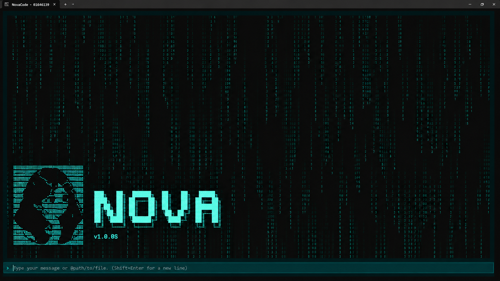

# NovaCode

An open-source coding assistant for your terminal. Nova reads your codebase, plans changes, edits files and runs checks, with persistent memory and a choice of cloud or local models.

Built with Python, LangGraph, deepagents and Textual. Licensed under [MIT](LICENSE).



## Why Nova

- **Memory you can explore:** linked Markdown notes, topic maps and `/dream` maintenance preserve useful knowledge across sessions.
- **Plan before changing code:** investigate in read-only mode, compare council proposals and approve a plan before implementation.
- **Work across projects:** run parallel session tabs and send explicit requests between their agents.
- **Choose your models:** use hosted providers or Ollama, with separate model roles for delegated work.
- **Keep work recoverable:** resume saved sessions, inspect context and restore supported file snapshots.
- **Extend your workflow:** add skills, MCP tools and plugins, or use headless mode for automation.

## Get started

Requires **Python 3.11+**, **Git** and **uv**. Configure a supported hosted provider or a running Ollama instance with a model installed.

```bash
git clone https://github.com/Babitdor/NovaCode.git
cd NovaCode
uv sync
uv run nova
```

First-run setup guides you through provider configuration and workspace approval. Provider API keys can be stored in the OS keychain. Hosted providers may charge for model usage.

To install a global `nova` command from this checkout:

```bash
uv tool install .
```

You can then run `nova` from your project's directory. After changing this checkout, reinstall the tool or use `uv run nova` to run the checkout directly.

## Everyday commands

| Command | Purpose |
|---|---|
| `/help` | Discover commands and keyboard shortcuts |
| `/model`, `/auth` | Choose models and configure provider access |
| `/plan`, `/council <task>` | Investigate a change or compare proposed plans |
| `/tabs`, `/resume` | Manage parallel sessions and reopen saved work |
| `/dream`, `/learning` | Organize the memory wiki and review generated learning |
| `/context`, `/compact`, `/usage` | Inspect context, compact history and view usage |
| `/settings`, `/theme` | Change interface settings, design and colors |
| `/mcp` | Manage external tool servers |
| `/restore` | Browse recoverable file snapshots |

Attach files with `@`; use **Shift+Enter** for a new line. Nova applies workspace, tool and path permissions; review approvals before granting broader access.

## Run from scripts

```bash
uv run nova -p "Summarize the changes in this repository"
uv run nova -p "Explain the project structure" --output-format json --max-turns 5 --timeout 120
```

One-shot mode exits after the task. It retains approval policies and reports when human input is required. Use `--auto-approve` only when unattended approvals are intended; `--deny-tools` rejects approval requests but does not disable every tool or guarantee read-only execution. Run `uv run nova --help` for all options.

## Optional capabilities

To install or update the global `nova` command with selected extras directly from GitHub:

```bash
uv tool install --upgrade "novacode-cli[voice,browser,agents-server] @ git+https://github.com/Babitdor/NovaCode.git"
```

To include all extras:

```bash
uv tool install --upgrade "novacode-cli[voice,voice-orpheus,voice-parakeet,voice-pocket,browser,bedrock,server,agents-server] @ git+https://github.com/Babitdor/NovaCode.git"
```

From a local checkout, use `uv tool install --upgrade ".[voice,browser,agents-server]"` instead. After installing the tool, launch it with `nova` from any project directory. Keep your desired extras in the install command when updating.

| Extra | Capability |
|---|---|
| `voice` | Local speech input and output |
| `voice-orpheus` | Optional Orpheus speech output |
| `voice-parakeet` | Optional Parakeet speech input |
| `voice-pocket` | Optional Pocket-TTS speech output |
| `browser` | Browser-use integration |
| `bedrock` | Amazon Bedrock provider |
| `server` | FastAPI and Uvicorn server dependencies |
| `agents-server` | On-demand background-agent server |

Install extras from the checkout as needed:

```bash
uv sync --extra voice          # Local speech input and output
uv sync --extra agents-server  # On-demand background-agent server
uv sync --extra browser        # Browser-use integration
```

Combine `--extra` flags to keep multiple extras installed. Voice models may need an initial download; browser integrations may need additional browser setup. Without the agent-server extra, in-process delegation remains available.

## Design and deployment integrations

Open `/mcp` to install **Figma**, **Vercel** or **Higgsfield**, then select **Authenticate** to sign in. No API keys or local server packages are needed for these hosted presets. You can also configure them with `nova mcp install figma`, `nova mcp install vercel` or `nova mcp install higgsfield`.

[Figma remote access](https://developers.figma.com/docs/figma-mcp-server/remote-server-installation/) is limited to approved clients. If Nova cannot connect, use the **Figma Desktop** preset with its desktop MCP server enabled and an eligible seat. [Vercel](https://vercel.com/docs/agent-resources/vercel-mcp) uses your account permissions; [Higgsfield](https://higgsfield.ai/creator-hub/help-center/integrations/how-do-i-connect-higgsfield-to-ai-agent) requires a paid subscription.

## Contribute

```bash
uv sync
uv run pytest tests/test_prompt_contracts.py -q --timeout=300
uv run ruff check novacode_cli/ tests/
```

Run tests relevant to your change; the full-suite command is `uv run pytest tests/ --timeout=300`. Report bugs or propose changes through repository issues and pull requests.

[Changelog](changelog/) · [License](LICENSE)
