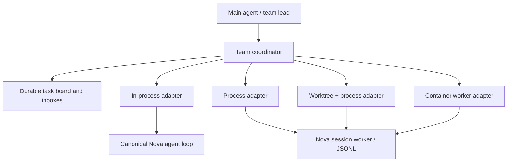

# Nova agent teams: architecture and migration plan

Status: design for review; no new execution modes are implemented by this document.
Audited 2026-10-20 against revision `36e5c83` and the working tree. Source files
may continue changing independently during review.

User decisions: design and migration plan before implementation; the first
remote target is a **Nova worker in a container**, not Claude Code Remote.
Preserve configured models, existing commands, approvals, histories and worktrees.
No new dependency, container provisioning, model call or publication is needed
for this design step.

## 1. Proposed architecture

Keep one agent implementation and introduce one transport-independent coordinator.
Execution adapters determine where an agent runs. They do not decide identity,
task ownership, permissions or which conversation state an agent can read.



The coordinator is a session runtime resource, independent of Textual. The TUI,
headless runner and remote bridges project its events through the existing
`ui_events` stream. Closing a view must not cancel unrelated workers. Coordination
does not require a visible tab, and a Telegram connection is a renderer/control
bridge rather than another kind of agent executor.

## 2. Current implementation and ranked gaps

| Priority | Evidence in current code | Design consequence |
| --- | --- | --- |
| P0 | [`agent_mailbox.py`](../novacode_cli/agents/agent_mailbox.py) stores `_mailbox` by agent name in process-global memory. `from_agent` and `as_agent` are tool arguments; clearing clears every inbox. | Replace its storage and identity boundary before persistent teams. Same-named agents in different sessions must not share inboxes. Legacy wrappers must not permit impersonation. |
| P0 | [`_harden_subagent_specs`](../novacode_cli/agents/core_agent.py) clears subagent interrupts and installs [`DelegatedApprovalMiddleware`](../novacode_cli/security/delegated_approval.py). Approval-requiring work is refused unless the dispatch context permits it. | Preserve this policy initially. Do not assume every child can open a parent approval dialog, and never equate delegation with auto-approval. |
| P0 | [`CheckpointCoordinator`](../novacode_cli/session/checkpoint_coordinator.py) coordinates graph mutations by thread. | Allocate an independent checkpoint/thread to every persistent teammate. Never have concurrent children mutate the lead's checkpoint or message list. |
| P1 | [`SessionSupervisor`](../novacode_cli/sessions/supervisor.py), [`SessionWorker`](../novacode_cli/sessions/worker.py) and [`protocol.py`](../novacode_cli/sessions/protocol.py) already provide subprocesses, event streaming, steering, cancellation and approval replies. | Reuse these foundations. Extract a transport/runtime interface rather than create a second worker loop. Model execution remains in [`iterate_agent_events`](../novacode_cli/core/agent_loop.py). |
| P1 | [`SessionBroker`](../novacode_cli/sessions/messaging.py) has bounded correlated messages; [`gateway.py`](../novacode_cli/sessions/gateway.py) binds identity through a `ContextVar`. [`SessionCommunication`](../novacode_cli/sessions/tui_messaging.py) contains TUI delivery logic. | Reuse identity binding, limits and correlation semantics; extract delivery scheduling from Textual. Keep project tabs distinct from team membership. |
| P1 | [`worktree.py`](../novacode_cli/sessions/worktree.py) creates worktrees and preserves dirty/ahead trees. It can fall back to shared files when Git or an initial commit is unavailable. | Explicit `worktree` spawn must reject unavailable isolation rather than silently fall back. Preserve current tab behavior for compatibility. |
| P1 | [`core_agent.py`](../novacode_cli/agents/core_agent.py) caches lazy compiled subagent graphs and stamps task metadata. [`subagent_tasks.py`](../novacode_cli/core/subagent_tasks.py) normalizes several event sources. | Preserve lazy construction and event attribution; compiled graph reuse is not a shared file cache or durable teammate identity. Stateful middleware needs per-agent instances. |
| P1 | [`async_subagents.py`](../novacode_cli/agents/default_subagents/async_subagents.py) already connects to LangGraph agents and checks workspace suitability. | Keep these tools operational during migration. A remote LangGraph specialist is not automatically a container teammate. Introduce an adapter only after its lifecycle and workspace contract are satisfied. |
| P2 | [`DockerBackend`](../novacode_cli/integrations/docker.py) executes individual tool commands; [`sandbox_factory.py`](../novacode_cli/integrations/sandbox_factory.py) manages sandbox lifecycles. | Reuse provisioning/path policies. Running shell commands in a sandbox is different from hosting the complete Nova worker and its bidirectional protocol there. |
| P2 | [`OptimizedFilesystemBackend`](../novacode_cli/backends/filesystem.py) handles filesystem tools. [`observations.py`](../novacode_cli/context/observations.py) only compresses duplicate observations after tools execute. | A coherent cross-process file cache is new work. Observation compression must not become stale-read caching or side-effect replay. |

The mailbox module's claim that subagents always run one at a time must not guide
the new design: concurrent task calls and dynamic fan-out already exist. Its
current tests cover name-based delivery, not team/session isolation.

## 3. Spawn modes and context ownership

| Mode | Runtime | Initial conversation | Workspace | Cache |
| --- | --- | --- | --- | --- |
| `default` | Async task in this process | Immutable snapshot of the parent's completed conversation, plus explicit task handoff | Parent workspace through a bound backend | Private observation view; optional shared immutable blobs |
| `fork` | New Python worker process | Fresh `messages[]`, explicit task/handoff only | Same approved workspace | Private view; validated file-cache service shared through coordinator |
| `worktree` | New worker process | Fresh messages and explicit handoff | Dedicated Git worktree from a recorded base commit | Separate workspace namespace; content blobs may deduplicate |
| `remote` | Nova worker in a managed container, initially local Docker | Fresh messages and explicit handoff | Explicit `/workspace` mount or versioned snapshot | Private view; container-local cache initially |

“Shared conversation” means **inherited context**, not a concurrently writable
Python list. Only completed turns/tool-call-result pairs enter a snapshot. A
child's detailed conversation stays in its own checkpoint; the parent receives
its result, artifacts and verification evidence. Subsequent messages are explicit.
Do not mutate the parent graph to attach a persistent teammate.

Inherited context is assembled within the child's actual input budget. Preserve
the current user request, corrections, approved plan, constraints and relevant
verification. Trim redundant observations first; if protected context cannot fit,
fail with a context-overflow error instead of dropping requirements. Record the
snapshot version/hash so a parent correction can be delivered and acknowledged at
the next safe boundary. Explicit corrections outrank peer suggestions.

`fork` is a product mode name. On Windows use the existing subprocess/exec model;
do not call `os.fork()` or clone live model connections, locks or MCP processes.
Only models/capabilities actually available to the session may be selected; do
not silently change providers or fall back between isolation modes.

Each agent gets its own messages, cancellation scope, loop guards, tool-call IDs,
usage attribution, middleware state and session/thread IDs. Shared resources are
explicit services, not a shared `SessionState`. Bind identity/policy using
context-local immutable values and reset tokens in `finally`. Do not use
process-global `os.chdir()` to give in-process teammates a different workspace.

Concurrent writers to a shared workspace need conflict detection and explicit
file ownership. Advisory reservations cannot constrain arbitrary shell commands;
use separate worktrees for parallel write tasks. In-process mode is suitable for
read-only collaborators or deliberately serialized writes, not a sandbox.

## 4. Coordinator, persistence and tools

Proposed package: `novacode_cli/teams/` with `models.py`, `store.py`,
`coordinator.py`, `gateway.py`, `scheduler.py` and `adapters/`. Keep these modules
independent of Textual. Extend worker/event protocol modules rather than duplicate
their serialization. File names here are proposed, not existing APIs.

Use a parent-owned SQLite store at
`~/.nova/sessions/<root-session-id>/teams.sqlite3`, opened lazily. Do not migrate
old session records. Partition every row by project identity and root session,
then by `team_id` and `agent_id`. The coordinator is the authoritative writer;
children access it through an identity-bound RPC endpoint, including in-process
children. Containers never receive direct database mounts. Bounded SQLite
transactions run off the UI loop; use durable sequence numbers and bounded replay.

Persist teams, agents, tasks, messages and lifecycle events. Retain immutable
events for diagnosis with an explicit retention policy. Agent display names are
labels, never primary keys or authorization credentials.

Proposed model-facing tools use Nova's snake_case conventions. The CamelCase
names in the brief map to these contracts:

| Tool | Required behavior |
| --- | --- |
| `team_create(name, swarm=false)` | Create a team owned by this root session; return stable ID, capability policy and effective limits. Creating a team alone starts no model work. |
| `team_delete(team_id)` | Lead-only: enter draining, reject new work, cancel owned agents, settle pending requests, then archive. Preserve task evidence, transcripts and dirty worktrees; no forced deletion. |
| `spawn_agent(task, mode="default", team_id=null, agent_type="general-purpose")` | Validate mode/capabilities and reserve capacity atomically before launching. Return stable agent ID, accepted mode and startup status. Existing specialist names remain usable. |
| `list_agents(team_id)` / `get_agent(agent_id)` | Return bounded lifecycle, task, transport and usage summaries, not whole conversations. |
| `cancel_agent(agent_id)` | Lead or authorized owner cancels only that agent and its owned descendants. Finish cleanup and release reservations exactly once. |
| `send_message(to_agent, message, reply_to=null)` | Bind sender from the runtime. Validate recipient membership; persist an idempotent, bounded message before reporting acceptance. Return message ID and delivery state. |
| `read_messages(cursor=null)` / `ack_message(message_id)` | Read only the caller's inbox. Delivery acknowledgment is distinct from task acceptance/completion. Use stable cursors; do not consume another agent's messages. |
| `task_create(team_id, title, description, depends_on=[])` | Lead creates a durable task with constraints and validation criteria; reject dependency cycles and cross-team references. |
| `task_list(team_id, cursor=null)` / `task_get(task_id)` | Bound output size; include dependencies, owner, version and artifact references. |
| `task_claim(task_id, expected_version)` | Atomic pending-to-running claim for this caller when dependencies and capability checks pass. Exactly one claimant wins. |
| `task_update(task_id, expected_version, status, result=null)` | Compare-and-swap; only current owner/lead can update. Completion includes evidence references. Dependency changes, reassignment and reopening are lead-only. |

Tool inputs must not contain trusted sender identity, approval mode, raw launch
argv, a database path, credentials or a container ID chosen by the model.
Configuration selects an allowlisted worker image/profile; the tool requests a
capability rather than inventing an executable command.

Legacy `send_agent_message`/`read_agent_messages` become compatibility wrappers
after identity binding is available. Reject a mismatched `from_agent`/`as_agent`
instead of honoring it. Legacy names resolve only within the caller's team and
must be unique; otherwise require an ID. `/clear` must never clear another
session's inbox. Preserve existing `task()` as synchronous one-shot delegation;
`spawn_agent` introduces persistent background teammates without silently changing
the semantics of old prompts.

### Task ownership and recovery

Task states: `pending`, `running`, `blocked`, `completed`, `failed`, `cancelled`.
Dependency waiting is represented explicitly. Running claims include an owner,
lease deadline and fencing generation. Use transactional compare-and-swap;
completion from an expired generation cannot overwrite a newer owner's work.

Use at-least-once event/message delivery with deduplicated acceptance, not an
unrealistic exactly-once execution promise. Store request IDs and acknowledgments
so a reconnect does not launch the same task twice. Uncertain shell/deploy side
effects become blocked for inspection, not automatically replayed. On restart,
reconcile persisted claims with live workers before accepting new work. An expired
lease is not proof that a remote process stopped; prevent a second writer until
the first is stopped/fenced or a human resolves the uncertainty.

Agent lifecycle: `starting`, `idle`, `running`, `waiting_approval`, `stopping`,
`stopped`, `failed`, `disconnected`. A disconnected worker is not a cleanly
stopped worker. Team lifecycle: `active`, `draining`, `archived`. Reconnect or
resume cannot implicitly grant a broader policy than the original run.

## 5. Messaging, scheduling and resource limits

Persist a message before scheduling its recipient. An idle teammate can be
woken; a running teammate receives messages at the next model boundary, after
the current tool returns. Never concurrently invoke the same agent/checkpoint,
inject text into a pending tool-result slot, or interrupt a side-effecting tool
as a shortcut. User cancellation and corrections retain priority over peer work.

Reuse the session broker's correlation, depth and payload-limit principles.
Adapt its 16 KiB message, 64 KiB reply, 256 retained requests and 32 pending per
recipient defaults where appropriate; expose effective bounds explicitly rather
than silently dropping unread messages. Store large results as authorized artifact
references, with bounded previews. Detect reply loops and failed recipients;
do not have agents poll each other in model calls.

One parent scheduler accounts for tab workers and team workers together. Preserve
the current four-process ceiling as the initial process budget; do not give each
team its own additional four slots. In-process concurrency, model requests,
container resources, recursion depth and total team size need separate bounds.
Reserve startup slots before awaiting launch, and release them on every failure
and cancellation path. Model retries keep the existing provider policy and usage
attribution; they must not multiply launches or count provider usage twice.

Workers report progress, completion and mailbox-ready events. Queue acknowledgments
and low-cost host timers are separate from LLM calls. Record input/output/cache
usage, model, purpose, parent agent, task and attempt IDs for every adapter. A
shared file cache is not a provider prompt cache and does not guarantee token
savings. Provider-unobserved retry usage stays unavailable, not zero.

## 6. File cache contract

Separate immutable content blobs from an agent's observation/index view. Fork
workers may share the blob service; swarm agents always have separate views and
workspace namespaces. This reconciles “shared fork cache” with “isolated swarm
cache” without sharing mutable file state.

Resolve and authorize each path against the caller's actual workspace before a
cache lookup. Key observations by workspace identity, canonical path, byte/range
and encoding semantics, plus verified file content version. Filesystem timestamps
alone are insufficient: same-size rewrites, coarse timestamps, atomic replacement
and symlink changes must invalidate observations. Use content hashes and
validated-read checks; disable reuse when freshness cannot be established. A
metadata match must not falsely claim that bytes were re-read.

Writes/edits invalidate affected views. An arbitrary shell command may modify
any file, so subsequent reads must validate against the filesystem rather than
trust tool-based invalidation alone. No caching/replay of shell execution or
other side effects. Do not share approvals, environment secrets, directory
authorization or mutable tool results through the cache. Implement reuse only
after correctness tests and an offline benchmark show a worthwhile benefit.

## 7. Container remote adapter: first target

Run the same Nova worker and canonical agent loop inside a configured, compatible
container. Begin with local Docker; remote Docker hosts/SSH and Claude Code Remote
are later adapters, not implied by this first implementation.

Use a non-TTY, bidirectional framed/JSONL stream with stdout reserved for protocol
and stderr for bounded diagnostics. Reuse `ready`, `ev`, `interrupt`,
`interrupt_reply`, `prompt`, `cancel`, `turn_done`, `session_request` and shutdown
semantics. Add protocol version/capability negotiation, team RPC, heartbeat,
sequence/ack and reconnect fields. Unknown mandatory protocol versions fail
clearly; compatible optional fields remain backward-compatible.

Do not apply the current display-preview clipping rules to control-plane fields.
Identity, task constraints, policy, approval arguments and acknowledgments need
lossless validated encoding with explicit size rejection; clipping them would
change the operation being authorized. Large artifacts use references rather
than oversized control frames.

The handshake binds agent/team IDs, effective model, workspace mapping, base
revision, policy fingerprint and protocol version. Reject a wrong workspace or
incompatible worker before sending the task. Do not translate Windows paths by
string substitution: use explicit host/worktree-to-`/workspace` mappings and the
existing workdir-backend conventions. Artifacts carry their workspace provenance.

Prefer a dedicated worktree mount for write-capable tasks. Read-only workers get
read-only mounts. The broker grants only configured capabilities and required
model credentials through the existing secret-management path; never mount the
whole user profile, parent SQLite database or Docker socket. Do not log keys or
pass them in launch argv. Apply explicit CPU/memory/process/time/network policy.
Container provisioning and trusted image selection remain configuration/setup
actions, not arbitrary agent tool arguments. No image pull/build is part of the
design review or offline tests.

Keep a recorded owned container identity. Cancelling the Docker client process
does not prove the worker/container stopped: request shutdown, stop the owned
container with a deadline, verify termination and only then release its execution
lease. Do not remove a container owned by the user or another session. Preserve
unfinished artifacts when shutdown/transport status is uncertain.

## 8. Permissions and approval forwarding

The parent remains the user-facing approval boundary. Capability policy is
checked when spawning and again for each operation; explicit denies always win.
Team/task/message tools need their own authorization policy rather than a blanket
allowlist. An agent cannot create a more privileged child.

In the first migration stages retain delegated-action refusal and request that
the lead perform the restricted action. Add structured approval forwarding only
after protocol tests pass: correlate the exact worker/tool-call ID, normalized
arguments, workspace, policy generation and decision expiry. A changed request
requires another decision. Stale replies, worker exits, cancellation and timeout
must release every waiter without executing the action. Reconnect does not
replay already-approved side effects. Preserve the root session's explicit
auto-approve setting; neither default isolation nor containers enable it.

## 9. Feature-gated swarm

Proposed configuration: `agent_teams_enabled=false`, `swarm_enabled=false`, plus
explicit worker limits and a configured container profile. Configuration names
are provisional. Off means existing tool schemas, prompts and execution remain
unchanged. Register gated tools through progressive discovery; do not inject all
coordination schemas into every request.

Manual teams precede swarm. Enabling teams does not enable autonomous claiming.
When swarm is explicitly enabled, a lead creates a bounded task DAG and member
roster. The host scheduler wakes eligible idle members; they claim compatible
tasks atomically, execute, publish evidence and acknowledge results. The lead
reviews integration and verification. Claiming uses no standalone model-polling
loop and does not recursively expand the team.

Swarm members require isolated messages, file-cache views and cwd. Therefore use
`worktree` workers or isolated container workspaces; reject `default`/plain
shared-cwd `fork` for this swarm contract. Mode choice remains explicit, not a
silent conversion of `default` into another isolation mode. The lead owns merge
ordering and conflict resolution. Neither completion nor team deletion merges,
commits, discards or publishes work automatically.

## 10. Migration sequence and review gates

| Phase | Concrete change | Acceptance gate / rollback |
| --- | --- | --- |
| 0. Contracts | Approve this design, tool schemas, isolation defaults, protocol and fixtures. Record current behavior and usage. | Offline baseline; no runtime changes. |
| 1. Coordination core | Implement `teams` identities, parent-owned store, lifecycle, inboxes, tasks and resource scheduler. Extract broker logic from Textual without changing tab UX. | Transactional claim races, session isolation, idempotency, bounds and restart tests pass. Feature flag off leaves old behavior unchanged. |
| 2. In-process teammates | Add persistent `spawn_agent(default)` using fresh hardened instances and unique checkpoints; keep one-shot `task()` unchanged. Bind tool identity per dispatch. | Context snapshot/precedence, pairing, cancellation and parent approval tests; no shared mutable histories or process cwd changes. |
| 3. Process and worktree | Adapt `SessionSupervisor`/worker, team RPC and strict worktree allocation. Reuse event normalization. | Real subprocess tests on Windows and POSIX; child startup/EOF/cancel paths and dirty-tree preservation. Rollback disables new adapters, not existing tabs. |
| 4. Cache | Add optional shared immutable blob service and private observation namespaces. | External edits, same-size rewrites, symlinks and worktree isolation tests; offline benchmark confirms value. Bypass cache immediately on uncertainty. |
| 5. Container | Add managed Nova worker container transport, handshake, workspace mapping and verified cleanup. | Fake transport tests first, then separately configured local-container tests with scripted models and no provider calls. Remote unavailable remains an explicit error. |
| 6. Approval and legacy adapters | Add tested approval forwarding; route old mailbox wrappers through scoped identity; bridge legacy async specialists only where semantics match. | No impersonation, stale approvals, cross-project reads, changed model defaults or unobserved usage. Deprecate globals only after compatibility tests pass. |
| 7. Swarm | Enable bounded task-DAG scheduling on isolated worker modes. | Restart/fencing, lease-loss, budget exhaustion, mixed transport and integration-conflict tests; independent swarm kill switch. |

Each phase is a separately reviewable change with focused tests, applicable
lint/type checks and final diff review. Runtime phases require a broader suite;
investigate failures against the unchanged baseline instead of weakening tests.
Existing saved sessions need no migration merely to keep working. Preserve old
commands/tool behavior until their explicit adapters are enabled. No live model
quality claims follow from scripted replay tests; evaluate real task outcomes
separately with an approved budget.

### Executable acceptance scenarios for implementation

1. Two roots each spawn `reviewer`: neither can read, send as, clear, cancel or
   claim work for the other's agent, including through legacy wrappers.
2. Two agents claim one pending task concurrently: one succeeds; the other gets
   a version conflict. A late completion from an old lease is rejected.
3. A child inherits a corrected requirement and a complete tool pair, never a
   partially emitted assistant/tool turn. Updating its messages cannot alter the
   parent's checkpoint. Protected-context overflow reports a clear error.
4. On Windows `fork` launches a real independent process, starts fresh messages
   and preserves the parent's configured model and effective policy.
5. `worktree` with no Git/commit returns unavailable isolation, not shared files;
   shutdown preserves dirty and ahead worktrees and their evidence.
6. Queue a peer message during a long tool: the next safe model step sees it;
   the tool runs once, the result is paired, and no second invocation races it.
7. Cancel child A: child B and the root continue. Close a UI tab/view: ownership
   policy, not active selection, determines which workers stop.
8. Kill the parent/worker before and after task acceptance: reconnect reconciles
   live execution, deduplicates requests and blocks uncertain side-effect replay.
9. An external same-size file rewrite, atomic replacement or symlink retarget
   cannot return stale cached bytes. Identical relative paths in two worktrees
   remain separate observations.
10. A remote handshake names the wrong workspace/model/protocol: no task runs.
    Drop the connection during cancellation: the process is not reported stopped
    until the owned container is verified stopped or marked uncertain.
11. Approval for an old worker/tool/argument/policy generation cannot authorize a
    new call. Deny survives auto-approve; cancellation clears approval waiters.
12. Turn team/swarm flags off: no team tools/prompt material or automatic model
    calls appear. Turn only teams on: no autonomous claims occur.
13. Exceed worker/message/token limits: return bounded errors without silently
    dropping unread work or starting extra workers. Count auxiliary usage once.
14. Lead integrates conflicting completed tasks: conflicts and required checks
    remain visible. No automatic merge, forced cleanup, release or push occurs.

## 11. Verification for this design review

Read the implementation paths linked above and ran existing offline regressions:

```powershell
.venv/Scripts/python.exe -m pytest tests/test_agent_mailbox.py tests/test_session_messaging.py tests/test_session_supervisor.py tests/test_session_worker.py tests/test_subagent_registration.py tests/test_subagent_resilience.py -q --timeout=90 -p no:cacheprovider --tb=short
```

Result: **79 passed**. Supervisor tests use real subprocess pipes with scripted
children, not paid models. This validates existing building blocks only: none of
the new team, transactional-claim, cache, container or swarm contracts above has
been implemented or proven yet. No provider requests, container startup, new
dependency, permission-policy changes or push were performed for this review.

Separately, the requested Windows-renderer rollback was verified with
`tests/test_nova_avatar.py` and `tests/test_build_avatar.py`: **16 passed**. The
current character renderer still uses its packaged PNG atlas as source data; that
is distinct from the removed native window renderer.

## 12. Implementation status (2026-10-20)

Section 11 records the original design-review baseline. Subsequent implementation
adds opt-in team coordination, persistent in-process teammates, new-process and
strict-worktree adapters, a configured container adapter, policy-bound approval
forwarding, scoped legacy inboxes and a separate swarm flag. Both flags remain
off by default. Usage stays on the existing accounting path.

The accepted cache phase remains gated pending correctness and benchmark evidence;
no shared file-read cache was enabled. Restart provides cleanup-only reconciliation,
not live execution adoption or model-stream resume. Container integration and
real-model quality remain unverified. These are explicit gaps against the full
acceptance scenarios, not completed rollout gates.

See [usage and configuration](AGENT-TEAMS.md) and
[implementation evidence and limitations](AGENT-TEAMS-EVIDENCE.md) for the
retained implementation, test results and broad-suite baseline comparisons.
